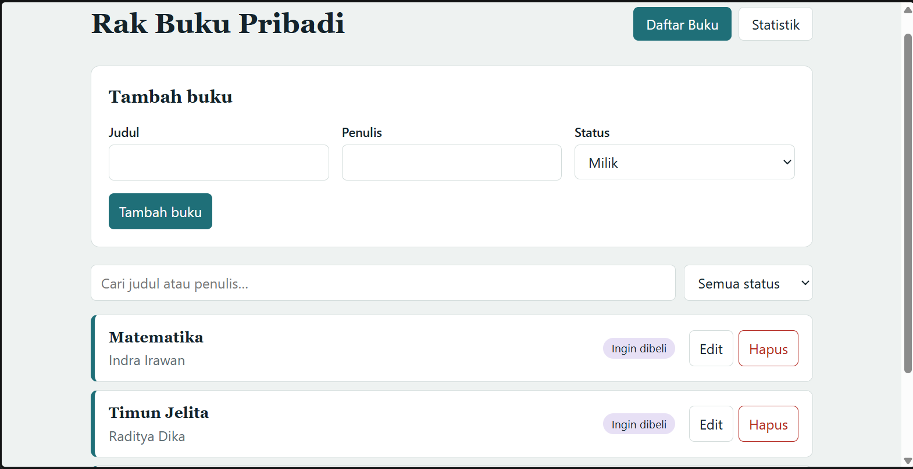
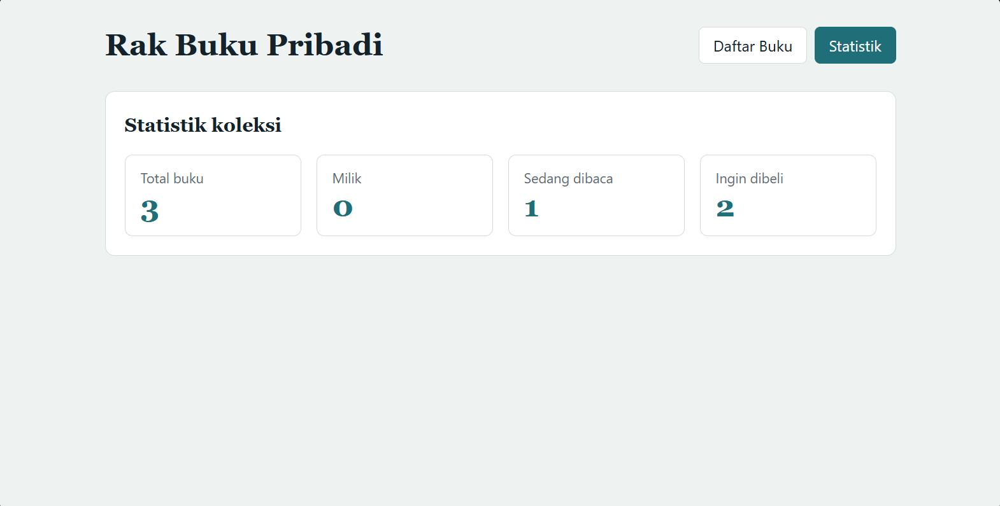
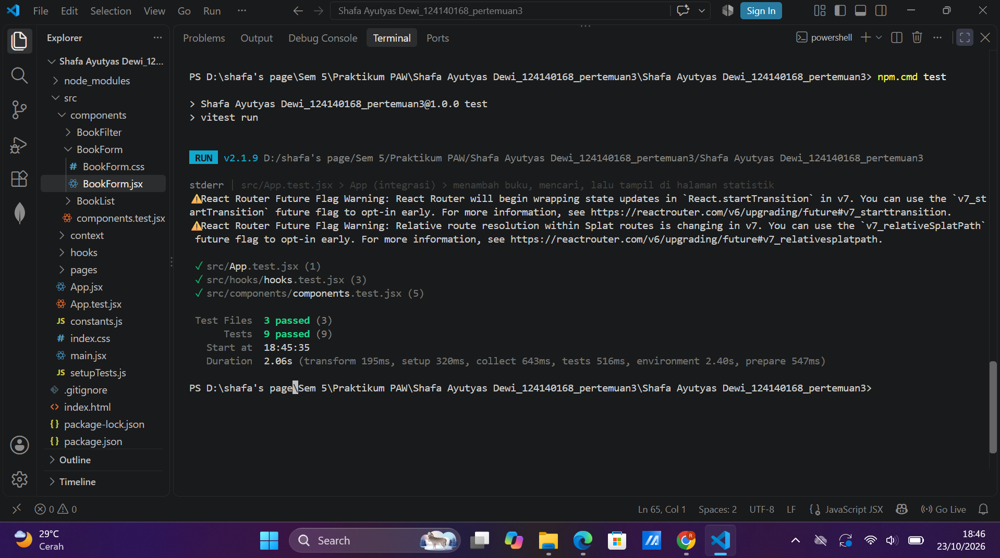

# Rak Buku Pribadi (Pertemuan 3 – React Basics)

## Deskripsi
Aplikasi manajemen buku pribadi untuk mencatat buku yang **dimiliki**, **sedang dibaca**, atau **ingin dibeli**.
Fitur: tambah, edit, hapus, filter status, pencarian judul/penulis, halaman statistik, dan data tersimpan di `localStorage`.

## Instalasi & Menjalankan
```bash
npm install
npm run dev      # buka http://localhost:5173
npm test         # unit test (Vitest + React Testing Library)
npm run build    # build produksi
```

## Screenshot






## Fitur React yang Digunakan
| Konsep | Lokasi |
|---|---|
| `useState` | `BookForm`, `Home`, `BookContext` (filter & pencarian) |
| `useEffect` | `hooks/useLocalStorage.js` (sinkron ke localStorage) |
| `useMemo`, `useCallback` | `useBookStats`, `BookContext` |
| Context API | `context/BookContext.jsx` (`BookProvider`, `useBooks`) |
| React Router | `App.jsx` (`/` dan `/stats`), `BrowserRouter` di `main.jsx` |
| Custom hooks | `useLocalStorage`, `useBookStats` |
| Komponen reusable | `BookForm`, `BookList`, `BookFilter` |
| PropTypes | seluruh komponen |
| Error handling form | `BookForm`: validasi judul & penulis, pesan error + border merah |
| Testing | `*.test.jsx`: 9 test (hooks, komponen, integrasi) |

## Struktur Folder
`components/`, `pages/`, `hooks/`, `context/`, `constants.js`.
