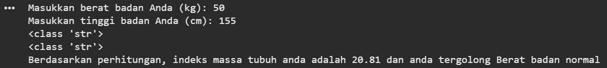
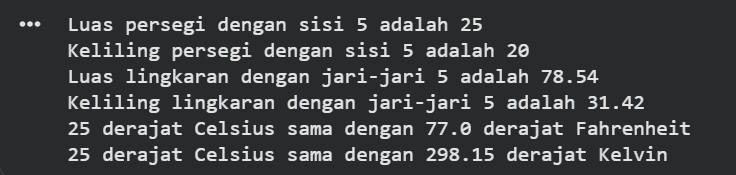

# Laporan Praktikum PAW (Pertemuan 4)

-   **Nama:** Shafa Ayutyas Dewi
-   **NIM:** 124140168

## Deskripsi Program

Repository ini berisi tiga tugas pemrograman Python yang menerapkan
konsep input-output, konversi tipe data, operasi aritmetika,
percabangan, perulangan, struktur data, fungsi, dan module.

### Soal 1 --- Menghitung Body Mass Index (BMI)

**Berkas:** `tugas1_bmi.py`

Program meminta pengguna memasukkan berat badan dalam kilogram dan
tinggi badan dalam sentimeter. Input dikonversi menjadi `int`, lalu
program menghitung BMI dengan rumus:

``` text
BMI = berat badan (kg) / tinggi badan (m)²
```

Percabangan `if-elif-else` menentukan kategori BMI: 
- BMI \< 18,5: Berat
badan kurang 
- 18,5 ≤ BMI \< 25: Berat badan normal 
- 25 ≤ BMI \< 30: Berat badan berlebih 
- BMI ≥ 30: Obesitas

**Cara menjalankan di terminal:**

``` bash
python tugas1_bmi.py
```

Masukkan berat badan dan tinggi badan ketika diminta.

**Screenshot hasil eksekusi Soal 1:**



### Soal 2 --- Pengolahan Nilai Mahasiswa

**Berkas:** `tugas2_nilai_mahasiswa.py`

Program menyimpan data mahasiswa dalam list berisi dictionary. Setiap
data memuat nama, NIM, nilai UTS, UAS, dan tugas.

Alur kerja: 
1. Menghitung nilai akhir dengan bobot UTS 30%, UAS 40%, dan
tugas 30%. 
2. Menentukan grade menggunakan `if-elif-else`. 
3. Menampilkan nama, NIM, nilai akhir, dan grade setiap mahasiswa. 
4. Mencari nilai akhir tertinggi dengan `max()` dan terendah dengan
`min()`. Parameter `key` menggunakan `lambda` untuk menentukan nilai
yang dibandingkan.

**Cara menjalankan di terminal:**

``` bash
python tugas2_nilai_mahasiswa.py
```

**Screenshot hasil eksekusi Soal 2:**

.png)
.png)

### Soal 3 --- Operasi Geometri dan Konversi Suhu dengan Module

**Berkas:** `math_operations.py` dan `main.py`

Soal ini menerapkan modularisasi. File `math_operations.py` berisi
fungsi yang dapat digunakan kembali, sedangkan `main.py` mengimpor dan
menjalankan fungsi-fungsi tersebut.

Fungsi pada `math_operations.py`:

  ---------------------------------------------------------------------------------------
  Fungsi                                              Kegunaan
  --------------------------------------------------- -----------------------------------
  `hitung_luas_persegi(sisi)`                         Menghitung luas persegi

  `hitung_keliling_persegi(sisi)`                     Menghitung keliling persegi

  `hitung_luas_persegi_panjang(panjang, lebar)`       Menghitung luas persegi panjang

  `hitung_keliling_persegi_panjang(panjang, lebar)`   Menghitung keliling persegi panjang

  `hitung_luas_lingkaran(jari_jari)`                  Menghitung luas lingkaran

  `hitung_keliling_lingkaran(jari_jari)`              Menghitung keliling lingkaran

  `konversi_suhu_celsius_fahrenheit(celsius)`         Mengonversi Celsius ke Fahrenheit

  `konversi_suhu_celsius_kelvin(celsius)`             Mengonversi Celsius ke Kelvin
  ---------------------------------------------------------------------------------------

File `main.py` mengimpor module menggunakan
`import math_operations as mo` serta mengimpor dua fungsi konversi suhu.
Program utama menghitung luas dan keliling persegi serta lingkaran,
kemudian mengonversi suhu 25 derajat Celsius ke Fahrenheit dan Kelvin.

**Cara menjalankan di terminal:**

Pastikan `main.py` dan `math_operations.py` berada dalam folder yang
sama, lalu jalankan:

``` bash
python main.py
```

**Screenshot hasil eksekusi Soal 3:**



## Struktur Folder

``` text
tugas-python/
├── README.md
├── tugas1_bmi.py
├── tugas2_nilai_mahasiswa.py
├── math_operations.py
├── main.py
├── soal1_bmi.png
├── soal2_nilai_mahasiswa(1).png
├── soal2_nilai_mahasiswa(2).png
└── soal3_module.png
```
