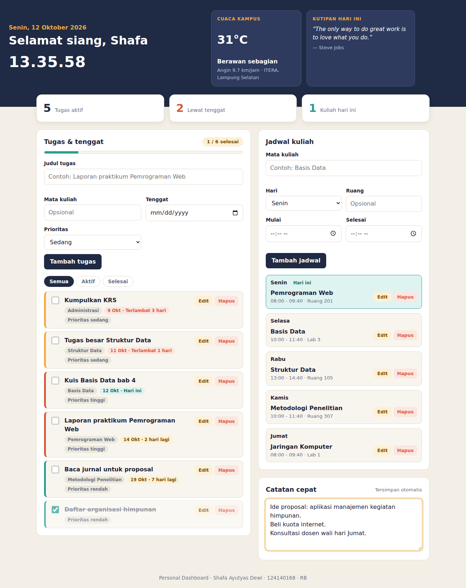
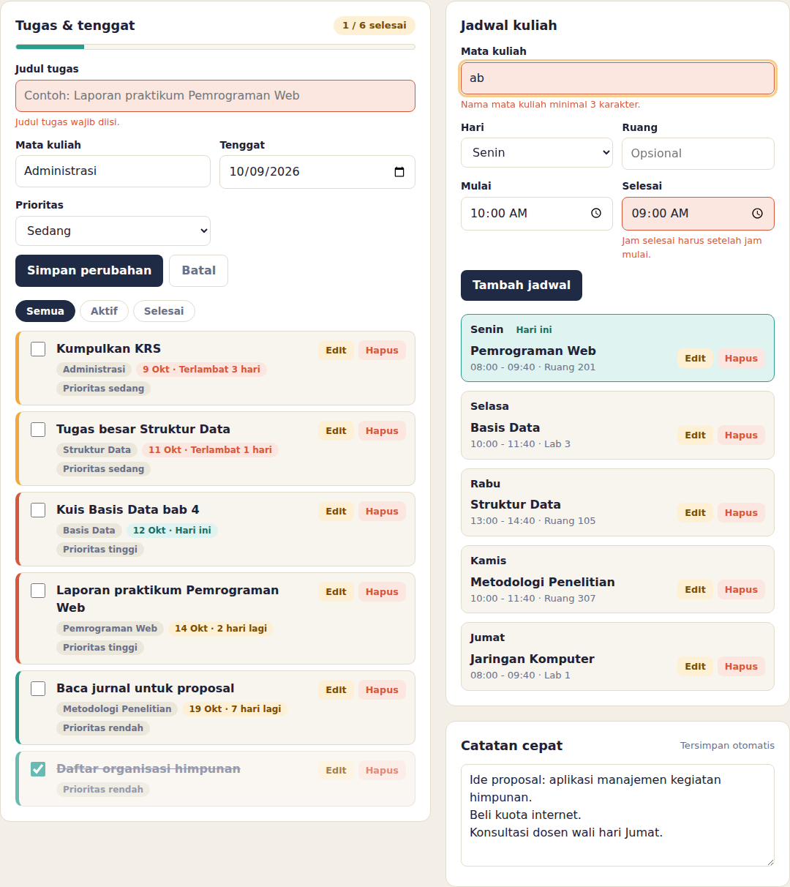
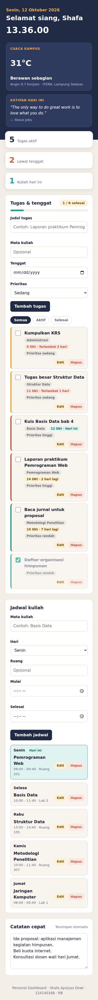

# Personal Dashboard Mahasiswa

Aplikasi dashboard pribadi sederhana untuk membantu mahasiswa mengatur tugas kuliah, jadwal perkuliahan, dan catatan harian dalam satu halaman. Dashboard juga menampilkan jam dan tanggal real-time, cuaca di sekitar ITERA, kutipan motivasi, serta ringkasan progres tugas.

## Fitur Utama

- **Manajemen tugas (CRUD):** menambah, mengedit, menghapus, dan menandai tugas sebagai selesai.
- **Informasi tugas:** mata kuliah, tenggat, dan tingkat prioritas.
- **Filter dan pengurutan tugas:** membantu memusatkan perhatian pada tugas yang belum selesai dan tenggat terdekat.
- **Manajemen jadwal kuliah:** menambah, mengedit, dan menghapus jadwal yang berisi mata kuliah, hari, waktu, dan ruang.
- **Catatan pribadi:** catatan disimpan otomatis ketika pengguna mengetik.
- **Ringkasan progres:** menampilkan informasi tugas, termasuk tugas selesai dan tugas terlambat.
- **Jam dan tanggal real-time:** menyesuaikan waktu perangkat.
- **Widget cuaca:** mengambil informasi cuaca dari Open-Meteo untuk koordinat sekitar ITERA, Lampung Selatan.
- **Kutipan motivasi:** mengambil kutipan acak dari DummyJSON Quotes.
- **Data tugas awal:** mencoba mengambil contoh tugas dari JSONPlaceholder saat aplikasi belum memiliki data tugas tersimpan.
- **Penyimpanan lokal:** tugas, jadwal, dan catatan disimpan di `localStorage` browser.
- **Validasi formulir dan tampilan responsif:** membantu mencegah input yang tidak sesuai dan menyesuaikan tampilan dengan ukuran layar.

## Teknologi yang Digunakan

- HTML untuk struktur halaman.
- CSS untuk desain dan tata letak responsif.
- JavaScript ES6+ untuk logika, interaksi, pengelolaan data, dan integrasi API.
- `localStorage` untuk penyimpanan data di browser.
- Fetch API untuk mengambil data eksternal.

## Struktur File

```text
.
├── index.html
├── style.css
├── script.js
├── README.md
├── 01-dashboard.png
├── 02-validasi-dan-edit.png
└── 03-tampilan-mobile.png
```

## Cara Menjalankan Aplikasi

1. Ekstrak seluruh file dari ZIP ke satu folder.
2. Buka `index.html` melalui browser. Untuk hasil yang lebih konsisten, jalankan folder menggunakan ekstensi **Live Server** di Visual Studio Code.
3. Pastikan koneksi internet aktif agar widget cuaca, kutipan, dan pengambilan data tugas awal dari API dapat digunakan.
4. Tambahkan tugas atau jadwal melalui formulir yang tersedia, lalu coba edit, hapus, atau tandai tugas sebagai selesai.
5. Muat ulang halaman untuk memeriksa apakah tugas, jadwal, dan catatan tetap tersimpan.

> **Catatan:** data `localStorage` tersimpan pada browser dan perangkat yang digunakan. Data tidak otomatis tersinkronisasi ke perangkat lain. Jika data browser dihapus, data dashboard yang tersimpan juga dapat hilang. API eksternal membutuhkan koneksi internet; aplikasi menyediakan penanganan ketika permintaan gagal.

## Screenshot Aplikasi

### 1. Dashboard utama



### 2. Validasi formulir dan pengeditan



### 3. Tampilan pada perangkat mobile



## Implementasi Fitur ES6+

Nomor baris di bawah merujuk pada file `script.js` dalam versi proyek ini. Jika kode diedit, nomor baris dapat berubah.

| Fitur ES6+ | Baris `script.js` | Keterangan |
|---|---:|---|
| `const` | 16–44 | Mendeklarasikan konstanta, konfigurasi API, label, dan data jadwal contoh. |
| `let` | 59–62 | Mendeklarasikan variabel `timer` yang nilainya berubah saat fungsi debounce dijalankan. |
| Arrow functions | 49–104 | Contoh: `$`, `pad`, `escapeHtml`, `debounce`, `fetchJson`, `parseTanggal`, dan `urutkanTugas`. |
| Template literals | 69, 86, 89, 122, 155, 275–278, 288–290, 301 | Membuat string dinamis, termasuk pesan, ID, jam, cuaca, dan kutipan. |
| Async/await | 67–71, 193–209, 253–295 | Mengambil data dari API secara asinkron dan menangani kegagalan permintaan. |
| Classes | 111–141, 144–161, 167 dan seterusnya | `TaskItem` memodelkan tugas, `ScheduleItem` memodelkan jadwal, dan `DashboardApp` mengelola aplikasi. |
| Destructuring | 112, 145, 217, 232, 273, 287, 406–408, 460–462 | Mengambil nilai properti objek ke variabel secara ringkas. |
| Spread operator | 135, 159, 219, 242, 262, 412, 466 | Menyalin atau menggabungkan properti dan array tanpa memodifikasi array lama secara langsung. |
| `map()` dan `filter()` | 411, 438, 446, 465 | Memperbarui atau menyaring item tugas dan jadwal. |
| `localStorage` | 213–245 | Membaca data menggunakan `getItem()` dan menyimpan data menggunakan `setItem()`. |
| Fetch API | 67–71, 253–295 | Meminta data JSONPlaceholder, Open-Meteo, dan DummyJSON. |

### Contoh implementasi

**Arrow function dan `async/await` (baris 67–71):**

```javascript
const fetchJson = async (url) => {
  const response = await fetch(url);
  if (!response.ok) throw new Error(`HTTP ${response.status}`);
  return response.json();
};
```

**Class dan spread operator (baris 111–141):** `TaskItem` memodelkan sebuah tugas. Method `dengan(perubahan)` menghasilkan objek tugas baru dengan menggabungkan properti lama dan perubahan menggunakan spread operator.

**Penyimpanan lokal (baris 213–245):** `muatDariStorage()` membaca data yang tersimpan, sedangkan `simpanKeStorage()` menyimpan state tugas, jadwal, dan catatan dalam format JSON.

## API Publik yang Digunakan

- **Open-Meteo:** `https://api.open-meteo.com/v1/forecast?latitude=-5.36&longitude=105.31&current_weather=true` — informasi cuaca saat ini.
- **DummyJSON Quotes:** `https://dummyjson.com/quotes/random` — kutipan motivasi acak.
- **JSONPlaceholder:** `https://jsonplaceholder.typicode.com/todos?_limit=5` — data contoh untuk inisialisasi tugas.

Ketiga API tersebut digunakan tanpa API key pada endpoint yang tercantum. Ketersediaan data bergantung pada layanan API dan koneksi internet.

## Pengujian yang Disarankan

- [ ] Menambah tugas dengan input valid.
- [ ] Memastikan input wajib yang kosong ditolak.
- [ ] Mengedit dan menghapus tugas.
- [ ] Menandai tugas selesai dan mengembalikannya ke status belum selesai.
- [ ] Menggunakan filter tugas.
- [ ] Menambah, mengedit, dan menghapus jadwal kuliah.
- [ ] Menulis catatan dan memuat ulang halaman untuk memeriksa penyimpanan otomatis.
- [ ] Memuat ulang halaman untuk memeriksa persistensi tugas dan jadwal.
- [ ] Memeriksa tampilan saat API tersedia dan saat koneksi internet terputus.
- [ ] Memeriksa tampilan pada layar desktop dan mobile.

## Pengembangan Selanjutnya

Aplikasi ini dapat dikembangkan dengan fitur notifikasi tenggat, ekspor data, sinkronisasi cloud, serta autentikasi jika dibutuhkan.
